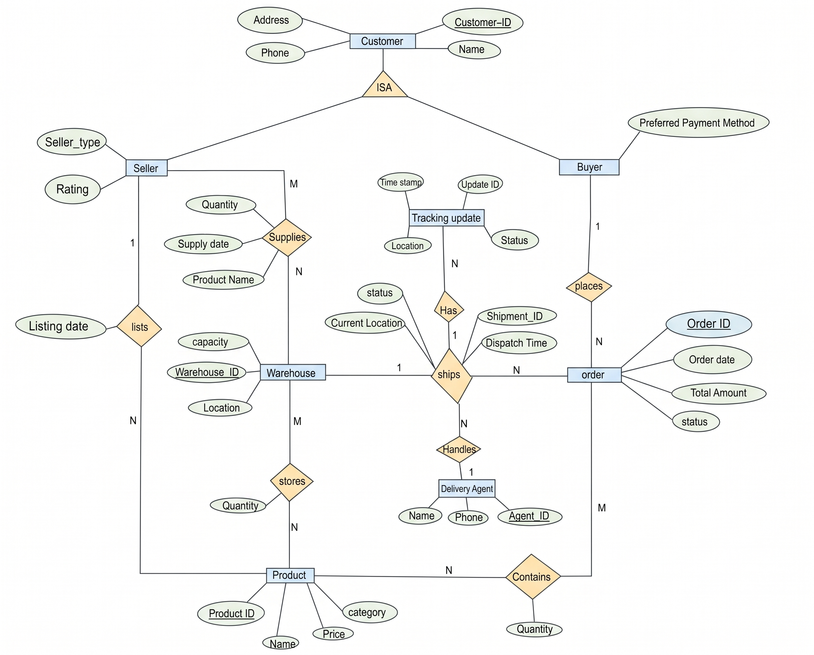

# Warehouse & E-Commerce Logistics Management System (DBMS)

A relational database management system (DBMS) built in SQL to model end-to-end e-commerce warehouse operations—covering multi-role users (buyers and sellers), supplier restocking, multi-warehouse inventory tracking, order processing, delivery agent assignment, and real-time shipment tracking.

## Key Architectural Highlights
* **ISA Specialization Hierarchy:** Separates shared attributes (`CUSTOMER`) from role-specific attributes (`BUYER` payment preferences and `SELLER` ratings/types) while enforcing referential integrity.
* **ER Aggregation Modeling:** Treats the `Warehouse–Order` shipping relationship (`SHIPS`) as an aggregated entity so it can independently link to `DELIVERY_AGENT` assignments (`HANDLES`) and multi-stage `TRACKING_UPDATE` logs.
* **BCNF Compliance:** Every relation is formally verified across 1NF, 2NF, 3NF, and Boyce-Codd Normal Form (BCNF), ensuring zero update, insertion, or deletion anomalies.
* **Historical Price Integrity:** Stores `Price_at_order` inside the `CONTAINS` relationship so future catalog price updates in `PRODUCT` do not corrupt past order invoices.

---

## Entity-Relationship Diagram


---

## Schema Overview (14 Tables)

| Table | Type | Primary Key | Purpose |
| :--- | :--- | :--- | :--- |
| `CUSTOMER` | Superclass | `Customer_ID` | Core identity and contact info for all platform users |
| `BUYER` | Subclass | `Customer_ID` | Preferred payment methods for purchasing customers |
| `SELLER` | Subclass | `Customer_ID` | Seller classification (`Individual`/`Business`) and rating |
| `PRODUCT` | Entity | `Product_ID` | Product catalog, category, and current listing price |
| `WAREHOUSE` | Entity | `Warehouse_ID` | Storage facilities, locations, and unit capacity |
| `DELIVERY_AGENT` | Entity | `Agent_ID` | Last-mile delivery personnel directory |
| `ORDER_TABLE` | Entity | `Order_ID` | Customer purchase orders, dates, totals, and status |
| `SHIPS` | Aggregated | `Shipment_ID` | Connects warehouses to orders with dispatch metadata |
| `TRACKING_UPDATE` | Entity | `Update_ID` | Chronological location and status logs per shipment |
| `CONTAINS` | Relationship | `(Order_ID, Product_ID)` | Line-item quantities and historical unit prices |
| `LISTS` | Relationship | `(Seller_ID, Product_ID)` | Tracks which sellers list which products and when |
| `SUPPLIES` | Relationship | `(Customer_ID, Warehouse_ID, Supply_Time)` | Inbound restock batches from sellers to warehouses |
| `STORES` | Relationship | `(Warehouse_ID, Product_ID)` | Current stock levels of each product per warehouse |
| `HANDLES` | Relationship | `(Agent_ID, Shipment_ID)` | Maps delivery agents to assigned shipments |

---

## Normalization Verification (BCNF)
All 14 tables satisfy **1NF through BCNF**:
* **1NF:** All attributes store single, atomic values with no repeating groups.
* **2NF:** Every non-key attribute in composite-key tables (`CONTAINS`, `STORES`, `SUPPLIES`, `LISTS`, `HANDLES`) is fully functionally dependent on the entire primary key.
* **3NF & BCNF:** Every non-trivial functional dependency has a candidate key (superkey) as its determinant, eliminating all transitive dependencies.

---

## Repository Structure
```text
warehouse-management-dbms/
├── docs/
│   └── er-diagram.png
├── sql/
│   ├── 01_schema.sql
│   ├── 02_seed_data.sql
│   └── 03_queries.sql
└── README.md
~~~

## Sample Query Outputs

### Query 3: Products in Order `401` (`PRODUCT ⨝ CONTAINS`)
| Name |
| :--- |
| Laptop |

### Query 5: Customers Who Placed at Least One Order (`CUSTOMER ⨝ ORDER_TABLE`)
| Name |
| :--- |
| Darshan |
| Riya |
| Neha |
| Simran |
| Priya |

### Query 6: Current Location of Each Order (`ORDER_TABLE ⨝ SHIPS`)
| Order_ID | Current_Location |
| :---: | :--- |
| 401 | Delhi |
| 402 | Delhi |
| 403 | Mumbai |
| 404 | Mumbai |
| 405 | Delhi |

### Query 7: Tracking History for Shipment `501` (`TRACKING_UPDATE`)
| Update_ID | Shipment_ID | Location | Timestamp | Status |
| :---: | :---: | :--- | :--- | :--- |
| 601 | 501 | Delhi | 2026-04-23 22:10:10 | Dispatched |
| 602 | 501 | Roorkee | 2026-04-23 22:10:10 | Out for Delivery |
